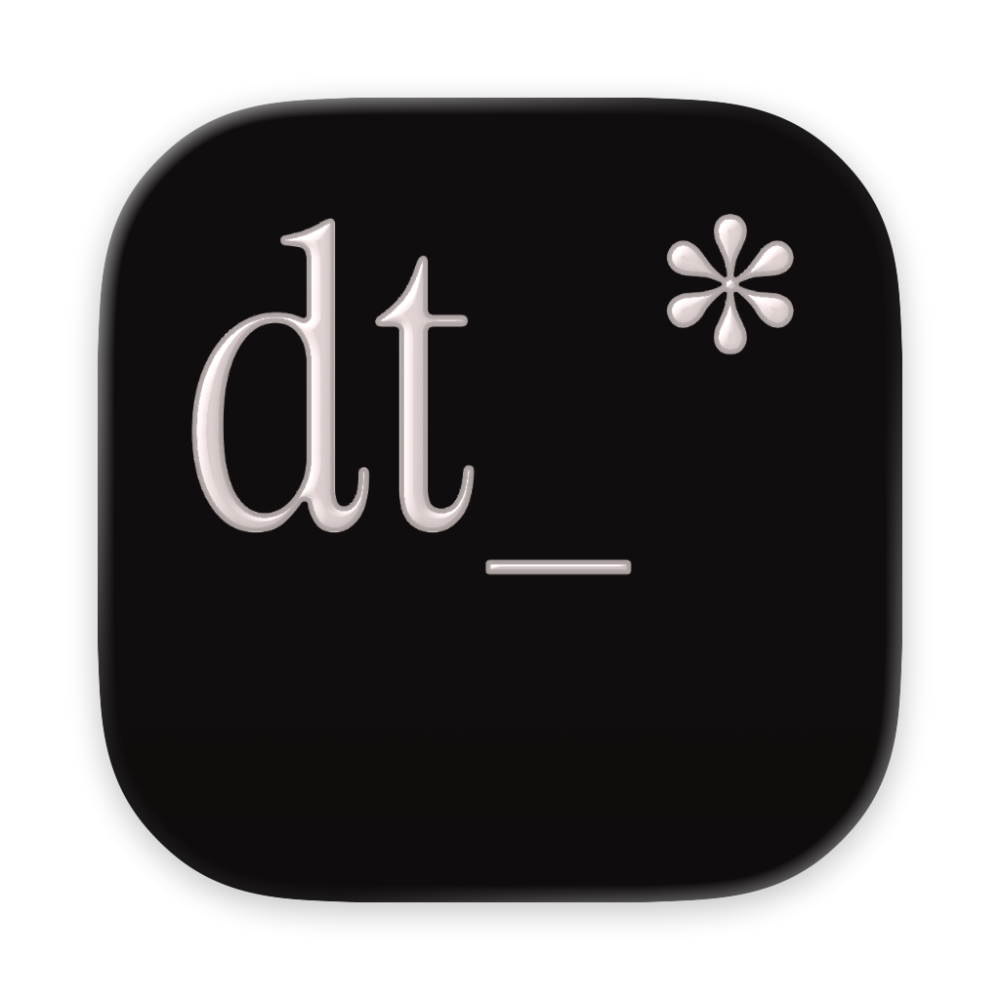
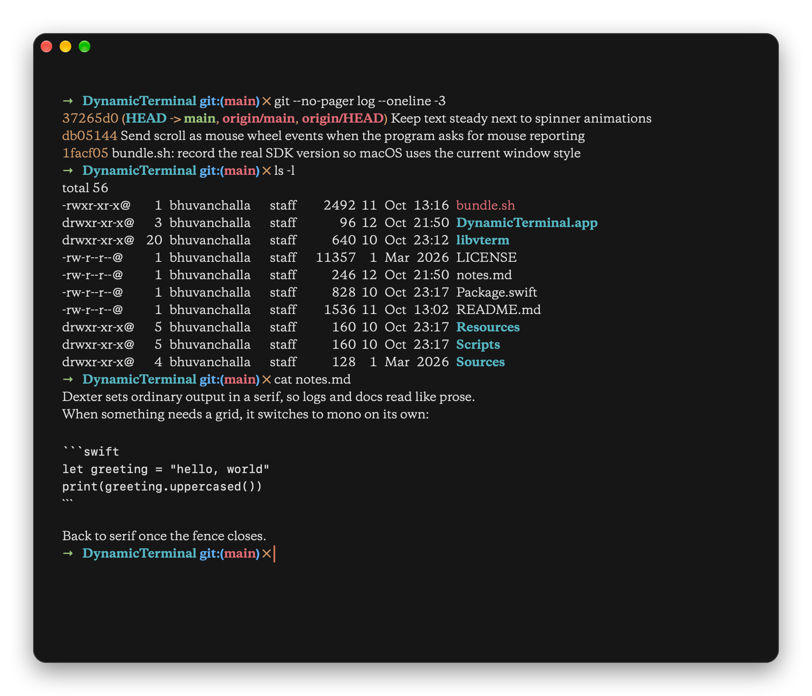
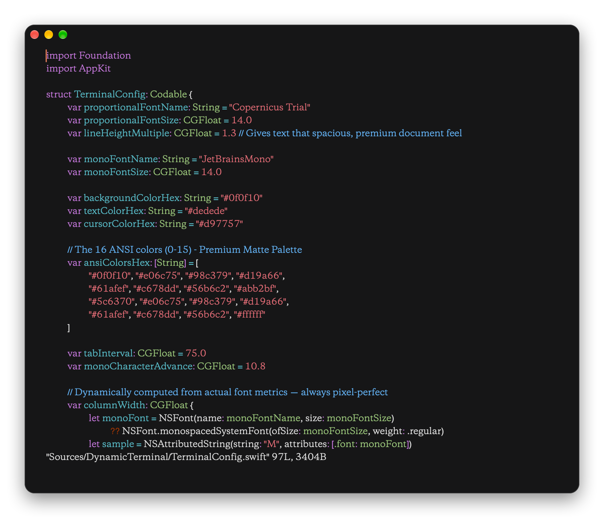

# Dynamic Terminal

A native macOS terminal that reads like a document.

Normal output is set in a proportional serif with generous line spacing. Anything
that needs a grid — code fences and box-drawing panels — switches to monospace
automatically, so they stay aligned.

<p align="center"></p>

<p align="center"></p>

Columns in tables like `ls -l` still line up in the serif. Full-screen apps such
as vim, less and Claude Code work too:

<p align="center"></p>

## Status

Early. It's my daily driver, but expect rough edges, especially with apps that
assume a fixed character grid.

## Requirements

- macOS 14 or later
- Swift 5.10+ (Xcode or Command Line Tools)

## Build

```sh
git clone --recurse-submodules https://github.com/bhuvchal/Dexter.git
cd Dexter
./bundle.sh            # builds a release binary and opens DynamicTerminal.app
```

For a quick debug run: `swift build && .build/debug/DynamicTerminal`.

The repo ships a prebuilt `Sources/CVTerm/libvterm.a`. To rebuild it from the
`libvterm` submodule:

```sh
cd libvterm
make CFLAGS="-O2 -mmacosx-version-min=14.0"
cp .libs/libvterm.a ../Sources/CVTerm/
```

## Configuration

Settings live in `~/.dynamicterminal.json` (created on first launch) and can be
edited from the Settings window. You can change the proportional and monospace
fonts, sizes, line height, and the 16-colour ANSI palette.

If the configured proportional font isn't installed, the system font is used.

## Extras

`search <query>` is on `PATH` inside the app's shells and prints web results
(via DuckDuckGo) right in the terminal.

## License

Apache 2.0 — see [LICENSE](LICENSE).
